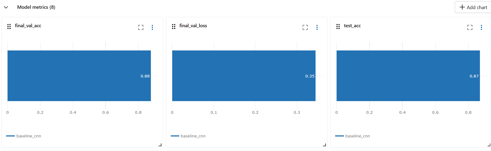
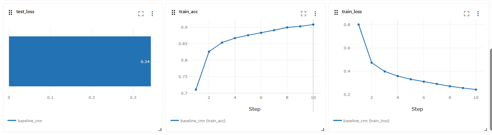
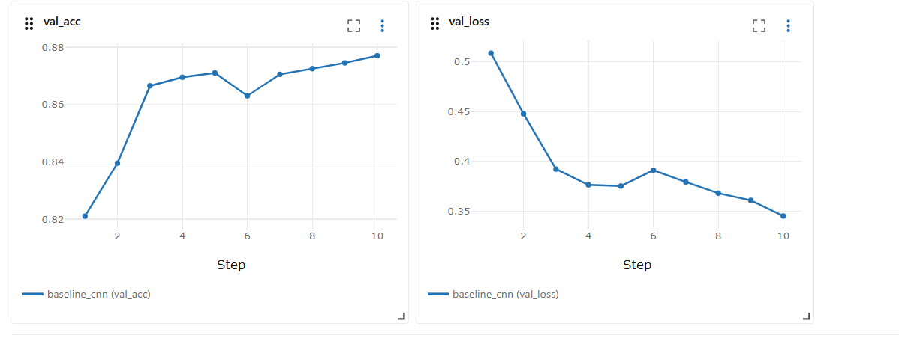
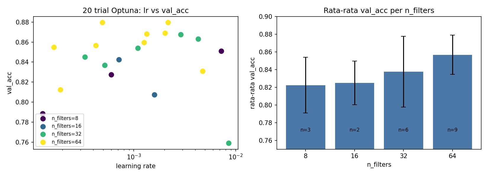
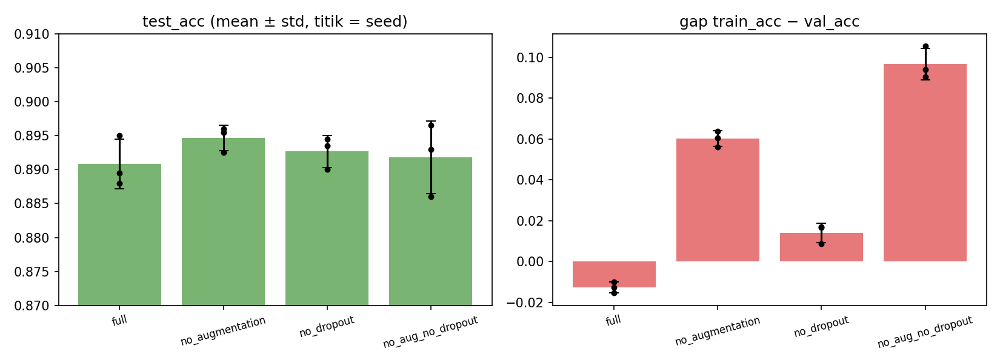

# Laporan: Eksperimen End-to-End CNN Fashion-MNIST dengan MLflow

## NAMA : IQFINA HAULA HALIKA
## NIM : 123450076
## KELAS : RA

**Setup.** Fashion-MNIST subset (10.000 train / 2.000 val / 2.000 test, diversi dengan DVC, md5 `8e47558d96213e622b898f69840c2dcf`).
MLflow tracking server lokal (SQLite + folder artifact), experiment `fmnist-cnn-e2e`, 40 run (baseline, 20 trial Optuna, 3 seed, 12 run ablation, dan run pendukung). Std = simpangan baku sampel (n = 3 seed).

## 1. Hipotesis

- **H1.** Hyperparameter tuning (Optuna, 20 trial) menghasilkan konfigurasi yang lebih baik daripada baseline CNN default.
- **H2.** Augmentasi data (random crop + horizontal flip) meningkatkan generalisasi: akurasi test naik **dan** gap train–val mengecil.
- **H3.** Dropout mengurangi overfitting sehingga akurasi test naik.

Kriteria: sebuah komponen dianggap terbukti membantu bila selisih rata-rata test_acc positif dan lebih besar dari std antar-seed.

## 2. Metode

| Tahap | Rincian |
|---|---|
| Baseline | CNN 2 blok konv (16 filter, hidden 64), tanpa augmentasi/dropout, lr 1e-3, batch 64, 10 epoch, seed 0 |
| Tuning | Optuna TPE, 20 trial sebagai nested run, objektif val_acc, 8 epoch/trial, seed 0. Ruang cari: `n_filters`, `hidden`, `dropout`, `lr`, `batch_size`, `weight_decay` (augmentasi dibuat tetap aktif) |
| Seed | Konfigurasi terbaik, 15 epoch, seed 0/1/2 |
| Ablation | Faktorial 2×2 (augmentasi × dropout), masing-masing 3 seed, 15 epoch |
| Registry | Model dengan val_acc tertinggi (bukan test) diregistrasi sebagai `fmnist-cnn`, alias `@champion` |
| DVC | Hash dataset dicatat sebagai param `dataset_md5` di setiap run |

Konfigurasi terbaik (trial 11): `n_filters=64`, `hidden=64`, `dropout=0.161`, `lr=0.00217`, `batch_size=128`, `weight_decay=1.6e-6`, `augment=True`.

## 3. Hasil

### 3.1 Baseline

Baseline (seed 0): val_acc **0.8770**, test_acc **0.8710**, train_acc 0.9085. Kurva loss dan akurasi per epoch turun/naik stabil tanpa tanda divergensi.

### 3.2 Tuning Optuna (20 trial)

val_acc antar-trial berkisar **0.7590 – 0.8795** (rata-rata 0.8427). Dua trial seri di 0.8795 (trial 11 dan 17); trial 11 dipilih Optuna.

| Trial | val_acc | n_filters | hidden | dropout | lr | batch |
|---|---|---|---|---|---|---|
| 11 | 0.8795 | 64 | 64 | 0.161 | 0.00217 | 128 |
| 17 | 0.8795 | 64 | 64 | 0.109 | 0.00049 | 32 |
| 12 | 0.8690 | 64 | 64 | 0.209 | 0.00203 | 128 |
| 13 | 0.8680 | 64 | 64 | 0.162 | 0.00134 | 128 |
| 6 | 0.8675 | 32 | 64 | 0.263 | 0.00290 | 64 |

Rata-rata val_acc naik seiring `n_filters`: 8 → 0.822 (3 trial), 16 → 0.825 (2), 32 → 0.838 (6), 64 → 0.857 (9). Tren ini indikatif saja karena TPE tidak mengambil sampel secara acak merata.

### 3.3 Konfigurasi terbaik, 3 seed

| Seed | val_acc | test_acc |
|---|---|---|
| 0 | 0.8945 | 0.8970 |
| 1 | 0.8745 | 0.8820 |
| 2 | 0.8805 | 0.8890 |
| **mean ± std** | **0.8832 ± 0.0103** | **0.8893 ± 0.0075** |

### 3.4 Baseline vs tuned

| Model | val_acc | test_acc |
|---|---|---|
| Baseline (1 seed, 10 epoch) | 0.8770 | 0.8710 |
| Tuned (3 seed, 15 epoch) | 0.8832 ± 0.0103 | 0.8893 ± 0.0075 |
| Selisih | +0.62 poin | **+1.83 poin** |

### 3.5 Ablation (3 seed)

| Varian | val_acc | test_acc | train_acc | gap (train − val) |
|---|---|---|---|---|
| full (aug + dropout) | 0.8838 ± 0.0067 | 0.8908 ± 0.0037 | 0.8712 | −0.0127 |
| no_augmentation | 0.8923 ± 0.0066 | 0.8947 ± 0.0019 | 0.9525 | 0.0601 |
| no_dropout | 0.8807 ± 0.0071 | 0.8927 ± 0.0024 | 0.8948 | 0.0141 |
| no_aug_no_dropout | 0.8872 ± 0.0068 | 0.8918 ± 0.0053 | 0.9838 | 0.0967 |

Efek tiap komponen pada test_acc (poin):

| Komponen | Saat komponen lain aktif | Saat komponen lain mati |
|---|---|---|
| Augmentasi (aktif − mati) | 0.8908 − 0.8947 = **−0.39** | 0.8927 − 0.8918 = **+0.09** |
| Dropout (aktif − mati) | 0.8908 − 0.8927 = **−0.19** | 0.8947 − 0.8918 = **+0.29** |

Catatan penting untuk membaca tabel ini:
- Semua selisih test_acc (≤ 0.4 poin) lebih kecil dari std antar-seed (0.2–0.5 poin).
- Run ulang dengan seed yang sama pun bisa berbeda: `seed_1` (3 seed) test_acc 0.8820 vs `full_seed1` (ablation, konfigurasi sama) 0.8880, selisih 0.6 poin, kemungkinan karena nondeterminisme operasi GPU.
- Test set hanya 2.000 sampel, sehingga standard error akurasi ≈ 0.7 poin.
- train_acc dihitung saat training (dropout aktif, data teraugmentasi), jadi gap pada varian `full` bernilai negatif dan tidak sebanding persis dengan gap varian lain.

### 3.6 Model Registry

Model dari run `seed_0` (val_acc tertinggi di antara 3 seed, 0.8945) diregistrasi sebagai `fmnist-cnn` dengan alias `@champion`, dimuat lewat `models:/fmnist-cnn@champion`.
Akurasi test hasil prediksi via alias (run `champion_predict`): **___** (isi dari metrik `champion_test_acc`; seharusnya ≈ 0.897, sama dengan `seed_0`).

## 4. Kesimpulan

**H1 :** Konfigurasi hasil tuning mencapai test_acc 0.8893 ± 0.0075 dibanding 0.8710 pada baseline (+1.83 poin, sekitar 2,4 std), dan val_acc naik 0.62 poin (masih dalam kisaran std). Dari 20 trial terlihat kapasitas model (`n_filters` lebih besar) paling konsisten terkait dengan val_acc yang lebih tinggi.

**H2 :** Augmentasi memperkecil gap train–val secara jelas (dari 0.097 menjadi 0.014 pada kondisi tanpa dropout), tetapi tidak menaikkan test_acc (−0.39 / +0.09 poin, di dalam noise). Jadi augmentasi mengurangi overfitting tanpa memberi keuntungan akurasi yang terbukti pada eksperimen ini.

**H3:** Dropout menurunkan gap (0.097 -> 0.060 tanpa augmentasi), namun efeknya pada test_acc (−0.19 / +0.29 poin) tidak lebih besar dari std.

**Kesimpulan** Perbaikan dari baseline ke model tuned lebih mungkin berasal dari kapasitas model, learning rate, dan batch size, bukan dari regularisasi (augmentasi/dropout): keempat varian ablation berada di 0.891–0.895, semuanya di atas baseline 0.871. Pada model `full`, train_acc (0.871) bahkan lebih rendah dari val_acc, sehingga regularisasi kuat dalam 15 epoch kemungkinan membuat model belum konvergen penuh. Dugaan ini belum diuji; langkah lanjutan adalah menambah epoch atau jumlah seed.

## 5. Keterbatasan

- Subset kecil dan test set 2.000 sampel (standard error ≈ 0.7 poin).
- Hanya 3 seed per varian; std dari n = 3 sangat kasar.
- Perbandingan H1 tidak sepenuhnya adil: baseline 1 seed/10 epoch, tuned 3 seed/15 epoch.
- Tuning memakai satu seed dan 8 epoch, sehingga trial terbaik bisa sebagian karena keberuntungan seed.
- Augmentasi dikunci aktif saat tuning, jadi konfigurasi terbaik tidak mempertimbangkan kemungkinan bahwa model tanpa augmentasi lebih baik.
